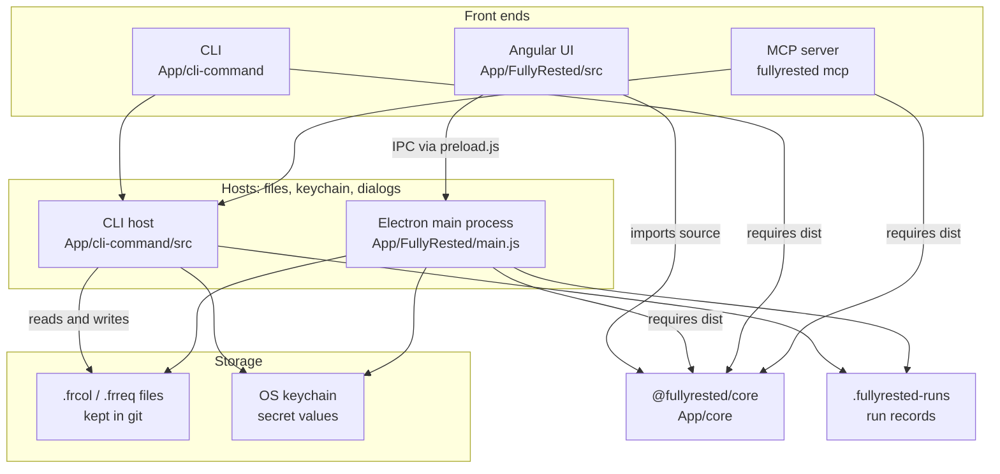

# FullyRested

Purpose: a desktop REST client whose requests are git-friendly JSON files,
with one shared engine behind both the desktop app and a command-line
runner. The intent and the user-facing concepts are in
[`README.md`](README.md).

## Tech stack

Angular 22 (Material) UI in an Electron 44 desktop shell / TypeScript 6 core library
(CommonJS; axios, Ajv, `@smithy/signature-v4`) / Node CLI (commander, vitest).
Nothing is deployed to AWS: the app is a local desktop app.

## Layers

| Layer | Where | Job |
|---|---|---|
| Front ends | `App/FullyRested/src` (Angular), `App/cli-command` (CLI commands, plus the MCP server in `mcp.ts`, which shares the CLI host and the same pipeline, and serves the authoring verbs by default) | Collect input and show results. Should hold no request logic of their own |
| Hosts | `App/FullyRested/main.js` + `preload.js`; `App/cli-command/src` (`files.ts`, `secret-store.ts`, `run-store.ts`, `inspect.ts`); the app's host also has `run-records.js` | Node-only work: reading and writing files, the keychain (`@napi-rs/keyring`), dialogs, and the process that sends requests. Each host also owns the websocket connection, using the `ws` package behind core's socket interface: `ws-transport.ts`, `ws-run.ts` and `ws.ts` in the CLI host, and `ws-transport.js` and `ws-sessions.js` in the app (one live session per open tab, over IPC). Electron main exposes `listDir` / `readText` / `getSecret` / `saveFolder` / `saveRun` / `listRuns` / `loadRun` over IPC (`run-records.js` is the node:fs half of the app's run store), and `collection-access.js` limits every file and keychain handler to the open collection's folder (its `runsPath` resolves the runs folder or one record id), request files chosen in a Save As dialog, and the secret services of files it has served; the CLI host reads collections through `FsCollectionSource` and writes them through `FsCollectionSink` (JSON at 4-space indent, so app-saved and agent-saved files do not churn in `git diff`), which resolves every path against the collection folder and refuses anything that escapes it — the same idea as `collection-access.js`, implemented a second time for the CLI. It also writes run records (`FsRunStore`, in `.fullyrested-runs`), and takes secrets from `FULLYRESTED_SECRET_<NAME>` before the keychain; `secret set` is the only path that writes a secret value, and it exists on the CLI alone |
| Core | `App/core/src` | The engine: model, the scope tree (`scope.ts`) and its loader (`tree.ts`, over a host `CollectionSource`), request builder, `{{var}}` / `{{$secret}}` substitution (plus the built-ins `{{$guid}}` and `{{$timestamp}}`), auth, sending, validation, moving secrets in and out of a `SecretStore`. For AI use: `run-record.ts` (the run record), `redact.ts` (`redactCase`, `secretReplacer`), `run-store.ts` (`RunStore`, `MemoryRunStore`), `file-run-store.ts` (`fileRunStore`, a store over host-injected file primitives; records are `<runId>.frrun` files, the extension being the `RUN_FILE_EXTENSION` constant; the `-app` id marker and the app's 200-record cap), `app-run.ts` (`buildAppRunRecord`), `query.ts` (summary, failures and case queries, with `json-path.ts` and `query-error.ts`) and `inspect.ts` (tree, environments, settings and show-request views). For authoring: `locator.ts` (parse a scope locator, resolve it against the tree), `collection-sink.ts` (`CollectionSink`, the write sibling of `CollectionSource`, plus `MemoryCollectionSink`), `authoring/` (one file per verb family over the shared `editScope` write path: `edit-scope.ts`, `create.ts`, `settings.ts`, `request-fields.ts`, `validation.ts`, `structure.ts`) with `authoring.ts` as the re-export barrel and only public entry point, `capture.ts` (capture rules: extracting a response value into a variable that `resolve({ captured })` layers over every scope; a run's optional `body` and `url` replace its request's, `none` sending no body; `multipart.ts` builds multipart/form-data bodies, `PreparedRequest.bodyBytes` carrying the exact bytes when the body is not text), and `infer.ts` (JSON Schema inference from a recorded body). For websockets: `websocket/` (next row) and the `authoring/websocket.ts` verbs (`set_type`, `set_message`, `set_expect`, `set_trigger`; `set_runs_only` in `request-fields.ts` sets `RestAction.runsOnly`, which `scope-cases.ts` honours; `authoring/structure.ts` rewrites a trigger's `request` when its target is renamed or moved, and warns on delete) |
| WebSocket | `App/core/src/websocket` (`socket.ts` the transport interface, `fake-socket.ts` an in-memory double for tests, `test-run.ts` the bounded test, `session.ts` the live session, `timeout.ts` the shared timeout rule) | One connection engine, two modes. A **test** sends `message`, checks each received message against `expect` and closes. A **live session** stays open, keeps the newest 1,000 events in memory (not written to disk) and is read by cursor. A test may carry a **trigger** (`model.ts` `WebSocketTrigger`, set by the `set_trigger` verb in `authoring/websocket.ts`): after the message is sent, `runWebSocketTest` waits `delay`, then calls the host-supplied `TriggerFirer.fire(signal)` once or every `interval` until the expect count is reached or the test ends, never overlapping and never after it ends. Each call is aborted after min(timeout, 10s); a call in flight at the end gets a 1.5s grace to be recorded before it is aborted and recorded as still pending. Core owns the loop and returns `triggerCalls` (`at` is ms since the test started), which the run record keeps (`websocket.triggerCalls`, redacted). Each host builds the firer by resolving the trigger's collection-relative request path to an http request (CLI `ws-run.ts` `buildTriggerFirer`; in the app the renderer's `execute-rest-calls.service.ts` `resolveTrigger` resolves it and `ws-sessions.js` only builds the firer around the resolved request), both firing through core's `fireTriggerRequest`. In a run, both hosts resolve the websocket request, its `expect` and its trigger with the run's captured values (CLI `run.ts` `runCase` → `ws-run.ts` `runWebSocketCase`; app `executeScope` → `sendWebSocket`/`resolveTrigger`); a websocket case only reads them and never captures. Trigger error text is redacted with the websocket and trigger requests' secrets together. Core takes the socket from the host, so it stays free of `node:` imports. The CLI, the MCP server and the app each call it and hold no websocket logic of their own |
| MCP requests | `App/core/src/mcp.ts` (envelope, handshake, SSE reply, the `mcp` check) and `App/core/src/authoring/mcp.ts` (`set_mcp`, `set_mcp_expect`) | A request of type `mcp` is an HTTP request in disguise: `scope.ts` resolves it to a POST of its JSON-RPC envelope with `ExecuteRestAction.mcp` set, `executeRequest` hands such a request to `executeMcp`, and `validateResponse` adds the `mcp` check. So every host, the run records and capture take it through the ordinary http path with no MCP code of their own; the app's request editor only describes the call |
| Storage | Collection folder on disk + OS keychain | The data. Secrets are held as references in files and as values in the keychain |

Core has no `node:` or `fs` imports, because the Angular build bundles its
source into the renderer. It compiles to CommonJS, which Electron's main
process and the CLI both `require()`. Anything that touches the machine
belongs in a host. `docs/reviews/2026-09-29-review.md`
records why the packages are linked with `file:` rather than npm workspaces.

## The request pipeline: what's shared

The UI and the CLI run one pipeline. Only file access and reporting differ:

| Step | Where it lives |
|---|---|
| Build the tree | core `loadCollectionTree` (`tree.ts`): the renderer over IPC in the app, `FsCollectionSource` in the CLI. Secrets are filled in by core `loadSecrets`, fields missing from older files by `normaliseAction` / `normaliseCollectionConfig` |
| Resolve settings: run → request → folders → environment → collection | `RequestNode.resolve()` / `RunNode.resolve()`, called by `ExecuteRestCallsService.executeNode` and the CLI's `runCase` |
| Show inherited settings | `effectiveSettings()`, used by the Inherited panel under the request and run editors |
| Substitute variables and secrets | core `replaceVariables` / `substituteDeep` |
| Authenticate and send | core `executeRequest`; the app calls it in `main.js` over the `testRest` IPC channel |
| Validate the response | core `validateResponse` |
| Record and query | core `run-record.ts` builds the run record, its cases numbered from 1; core `redact.ts` (`redactCase`) redacts each case, called from the CLI's `run.ts` unless `--include-secrets` is given; a `RunStore` keeps it (`FsRunStore`, one `.frrun` file per record, a wrapper over core's `fileRunStore`, on disk in the CLI; `MemoryRunStore` in the MCP server). The app records too: the renderer builds the record with `buildAppRunRecord` and writes it over the `saveRun` IPC channel; `query.ts` answers run-result (what MCP `run` returns), summary, failures and per-case questions for both the CLI commands and the MCP tools |
| Pick the cases to run | core `scope-cases.ts` (`casesFor` / `casesForScope`), used by the CLI, the MCP server and the app. The app runs a folder or the collection root with `ExecuteRestCallsService.executeScope`, builds one multi-case record with `buildScopeRunRecord` (alongside `buildAppRunRecord` for a single send), and `LatestResultsService` shows each request's latest result in its tab |
| Author: create or change a document | core `authoring/` over `editScope`: resolve the locator, read the document raw through `CollectionSource`, apply the verb, `normalise*`, `storeSecrets`, write through `CollectionSink` — `FsCollectionSink` in the CLI and the MCP server, `MemoryCollectionSink` in tests. The app still has its own write handlers in `main.js` |
| Report | Angular response components; the CLI's `report.ts` (text lines, JUnit XML) |

## Help

The user guides are `docs/help/` (`README.md` index, guides `01`-`10`, `images/`,
`sample-collection/`); that folder is the only copy. The app shows the same
pages under **Help**, the palette's "Help topics" and F1:
`App/FullyRested/src/app/components/help-viewer` renders them through
`services/help-markdown` (`marked`), reading the build copy described under
Running it. `window-links.js` sends external http(s) links to the system browser.

## Known limitations

Recorded because they are decisions rather than oversights — the code shows
what the guards do, not what they deliberately don't.

**The collection-folder guards are check-then-act.** Both hosts validate a
path and then call `fs`, so there is a window between the check and the
write. A local process that can already write *inside* the collection folder
can swap a checked directory for a symlink in that window, and the write
follows it out. Node offers no portable `O_NOFOLLOW` / `openat`, so closing
it properly needs a platform-specific file-handle API. Not taken: the threat
model is an attacker who already has write access inside the folder, and for
a single-user desktop tool whose collections live in git, `git diff` and
`git checkout` are the real safety net. Revisit if the threat model ever
includes a hostile local process.

What the guards *do* cover — escaping the folder, symlinked ancestors and
dangling symlinks — is core `collection-guard.ts`, shared by both hosts,
with the escape tests beside it.

## Where the plan lives

On the BlueFinWiki kanban board, under initiative **AI Refresh**
(`e58ec7d8-09c2-4d67-81b7-9b1b2e72d989`), with epics for the core engine,
secrets hygiene, the CLI runner, the stack upgrade and cleanup. Home's
`configuration/fullyrested/config.json` maps this repo to that initiative.
The `feature/collection-hierarchy` branch maps to the **Collection Hierarchy**
initiative (`78286444-4af7-4e63-9929-1a63a8b641c7`); `active` stays UI Refresh.
The `feature/ai-interface` branch maps to the **AI First** initiative
(`7cb3c7ac-1344-4db1-8cc9-81f1a14a7212`); its design is
`docs/superpowers/specs/2026-10-11-ai-interface-design.md`.
The `feature/authoring-apis` branch maps to the same **AI First** initiative
(`7cb3c7ac-1344-4db1-8cc9-81f1a14a7212`); its design is
`docs/superpowers/specs/2026-10-11-authoring-apis-design.md`.
The `feature/websocket-support` branch has its own **WebSocket Support**
initiative; its design is
`docs/superpowers/specs/2026-10-17-websocket-design.md`.
Running a folder or collection from the UI (UI Refresh) is designed in
`docs/superpowers/specs/2026-10-17-ui-run-scope-design.md`.
The `feature/ai-first-followups` branch maps to the same **AI First**
initiative and carries that board's tail: the review and follow-up tickets
left after the two epics shipped.
The `feature/app-run-records` branch maps to the same **AI First**
initiative; its design is
`docs/superpowers/specs/2026-10-15-app-run-records-design.md`.
The `feature/desktop-distribution` branch maps to the same **AI First**
initiative; its design is
`docs/superpowers/specs/2026-10-15-desktop-distribution-design.md`.
The `feature/help-docs` branch maps to the **Help & Docs** initiative
(`53ca2055-5193-4e84-9ca9-0338a9186979`); its design is
`docs/superpowers/specs/2026-10-19-help-docs-design.md`.
`docs/reviews/` holds dated reviews; they are snapshots, not living docs.

## Running it

Build order: the app's main process and the CLI load core's compiled
`dist/`, so build core before either. The Angular build compiles core's
source directly, through a `paths` mapping in `App/FullyRested/tsconfig.json`.

| Task | Command (from the folder shown) |
|---|---|
| Build core | `App/core`: `npm install && npm run build` |
| Test core (vitest) | `App/core`: `npm test` — `pretest` type-checks first |
| Type-check one package, tests included | `App/core` or `App/cli-command`: `npm run typecheck`. `tsconfig.json` covers `src` only and vitest never type-checks, so this is what catches a type error in a test |
| Run the desktop app | `App/FullyRested`: `npm run electron` (builds core, runs `ng build`, starts Electron) |
| UI only, in a browser | `App/FullyRested`: `ng serve`. With no Electron IPC, the repository and execute services return built-in mock data |
| Angular unit tests | `App/FullyRested`: `npm test`. The specs are still CLI boilerplate |
| Test the main process (node:test) | `App/FullyRested`: `npm run test:main` (also covers `run-records.js`) |
| Package installers | `App/FullyRested`: `npm run make` (electron-forge). Output lands in `out/make/` |
| Refresh the bundled help | `App/FullyRested`: `npm run build`, not bare `ng build` / `ng test`: its `prebuild` runs `scripts/help-index.mjs`, which copies `docs/help` into git-ignored `src/assets/help/` and writes `src/assets/help-index.json` |
| Retake help screenshots | `App/FullyRested`: `npm run help:screenshots [-- <shot-name>]` drives the real app (`scripts/help-screenshots.mjs`, one `scripts/shots/*.mjs` per guide; `scrub.mjs` strips real IPs and trace ids first). The sample collection hits httpbin.org and echo.websocket.org, so it needs the network |
| Launch env vars (`dev-hooks.js`) | `FR_REMOTE_DEBUGGING_PORT` (open a debugging port), `FR_OPEN_COLLECTION` (open this collection), `FR_USER_DATA` (use this userData folder), `FR_NO_DEVTOOLS` (no DevTools window). Used by the screenshot tooling |
| Cut a release | See [RELEASING.md](RELEASING.md): `npm version x.y.z` in `App/FullyRested`, then `git push --follow-tags` |
| Regenerate the icons | `App/FullyRested`: `npm run icons`, after `npm run icons:master` if `icons/source.png` changed. Output is committed |
| Build and try the CLI | `App/cli-command`: `npm run build` (builds core too), then `node dist/index.js run --help`; `npm link` puts `fullyrested` on the PATH |
| Test the CLI (vitest) | `App/cli-command`: `npm test` |
| Serve the MCP server | `App/cli-command`: `fullyrested mcp [--store <dir>]` (or `node dist/index.js mcp`). Stdout carries the protocol, so warnings go to stderr. Registration and tools are in the README |

Runtime state: the app keeps its open tabs and recent collections in
`current_state.json` in Electron's userData folder, and the request files
saved outside a collection (allowed through the IPC guard) in
`trusted_requests.json` beside it. Secrets are stored under
the keychain services `fullyrested-collection-<collectionGuid>` and
`fullyrested-request-<requestId>`; folder secrets use
`fullyrested-folder-<folderId>`.

## Distribution

Nothing here is deployed to AWS. Installers are published as **GitHub Release
assets** on `BlueFin605/FullyRested`, and that is the only place they are
stored. How a user installs one is in [`README.md`](README.md).

| Workflow | Trigger | Job |
|---|---|---|
| `.github/workflows/build.yml` | push to `master`, every PR | Builds and tests core, the CLI and the app on ubuntu/windows/macos, ending in `electron-forge package` — the step that proves `forge.config.js` still works on each platform |
| `.github/workflows/release.yml` | a `v*` tag, and nothing else | Checks the tag, builds all three platforms into one draft release, then publishes it |

Cutting a release is `npm version <x.y.z>` in `App/FullyRested` followed by
`git push --follow-tags`. `npm version` bumps, commits and tags together, so
the tag and `package.json` cannot drift — which the workflow then asserts,
along with the tagged commit being an ancestor of `master`.

Each platform's runner publishes into the same release, which stays a **draft**
until a final job confirms the Windows `RELEASES`, `*-full.nupkg` and
`Setup.exe` all arrived. Drafts are invisible to `update.electronjs.org`, so a
mistyped tag or a failed matrix leg leaves something to delete rather than
something users receive. Without `RELEASES` in particular, installs work
perfectly and auto-update silently never happens — hence the explicit check.

**Both workflows live in this public repo, not in Home.** That is a deliberate
deviation from the `bluefin-dev` layout, which puts deploy workflows in the
private repo. The split exists to keep environment-specific config and AWS
credentials out of public repos, and there are none here: the release
authenticates with the built-in `GITHUB_TOKEN`. Routing it through Home would
require a personal access token with write access to this repo — strictly
worse.

**The app ships unsigned.** An ACM certificate cannot sign code, and macOS
notarization needs a paid Apple Developer account. `forge.config.js` carries a
signing seam that reads absent environment variables, so adding certificates
later is a change to GitHub secrets rather than to the config. The cost to
users is a SmartScreen warning on Windows and a quarantine flag on macOS; both
are documented in the README.

**Auto-update is Windows only.** `main.js` calls `update-electron-app` against
`update.electronjs.org`, guarded on `app.isPackaged` and `win32`: the service
requires a signed app on macOS, and Squirrel does not apply on Linux. Any
failure is logged and ignored — an update check must never delay or block
startup, because the app has to keep working offline. macOS and Linux users
re-download.

The icons are generated from `App/FullyRested/icons/source.png` and committed,
not built on demand; `scripts/restore-alpha.mjs` explains why `master.png`
exists separately.
