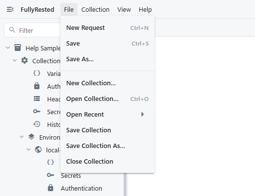
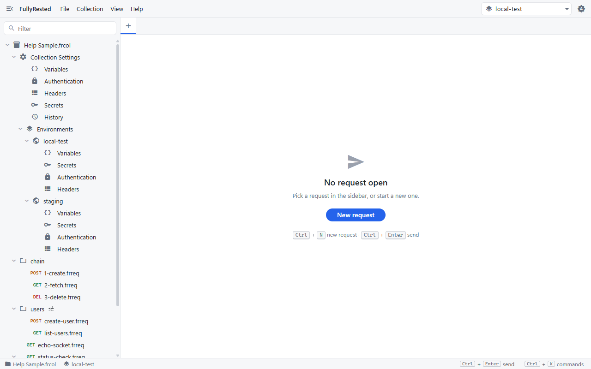
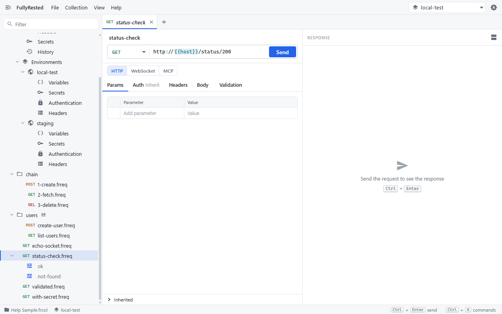
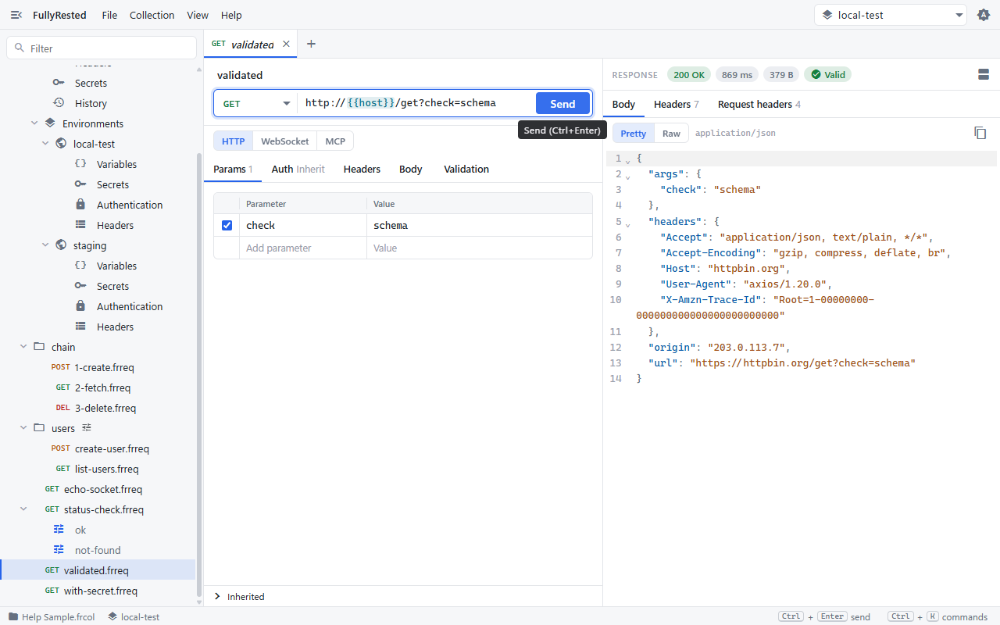

# Getting started

FullyRested is a desktop REST client where a collection is a folder of plain files, so it can live in git, and the same requests can be run from the command line. This guide takes you from opening a collection to sending your first request.

## Open or create a collection

1. Open the **File** menu.
2. Choose **Open Collection…** (Ctrl+O) to pick an existing `.frcol` file, **Open Recent** to reopen one you used before, or **New Collection…** to start an empty one.

When no collection is open, the main area also offers **Open collection…** and **New collection…** buttons and a list of recent collections.

## Find your way around the explorer

The sidebar on the left is the explorer. For the sample collection it shows:

- **Collection Settings** (Variables, Authentication, Headers, Secrets, History) for settings shared by everything in the collection.
- **Environments**, each with its own Variables, Secrets, Authentication and Headers.
- Folders and requests. Each request shows its method (GET, POST, DEL) next to its name; a request with runs expands to list them.

Use the **Filter** box at the top to narrow the tree by name. Press Ctrl+B (or choose **View > Hide Sidebar**) to hide the sidebar.

## Open a request

1. Click a request in the explorer, for example `status-check.frreq`. It opens in a tab above the editor.
2. The top of the editor holds the request name, the method picker, the URL and the **Send** button. Below are the tabs **Params**, **Auth**, **Headers**, **Body** and **Validation**.
3. `{{host}}` in the URL is a variable. It is filled in from the collection (or the selected environment) when you send.

The **Inherited** bar at the bottom of the request lists the settings the request picks up from its folders, environment and collection. Click it to expand.

To make a new request instead, choose **File > New Request** or press Ctrl+N.

## Send it and read the response

1. Click **Send**, or press Ctrl+Enter.
2. The response appears on the right. The badges at the top show the status, the time taken, the body size and, if the request has validation, **Valid** or the number of failed checks.
3. The **Body** tab shows the body as **Pretty** or **Raw** (and **Preview** for HTML and images). **Headers** shows the response headers and **Request headers** shows what was actually sent.

To put the response beside or below the request, use the layout button at the right of the response bar, or **View > Response Below Request**.

## Save your work

- **File > Save** (Ctrl+S) saves the open request to its `.frreq` file. A dot on the tab's close button marks unsaved changes.
- **File > Save As…** saves the request under a new name.
- **File > Save Collection** saves collection-level changes such as variables, environments and the selected environment. See [Collections and environments](02-collections-and-environments.md).

Because requests and collections are plain files, saving is also what you commit to git.

## Next

- [Collections and environments](02-collections-and-environments.md)
- [Folders and hierarchy](03-folders-and-hierarchy.md)
- [Shortcuts and more](10-shortcuts-and-more.md)

See also the command-line runner in [the main README](../../README.md#command-line-runner).
