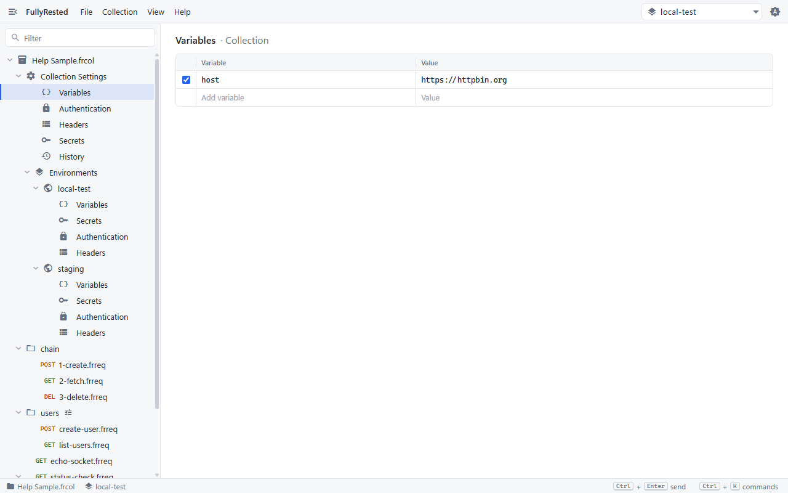
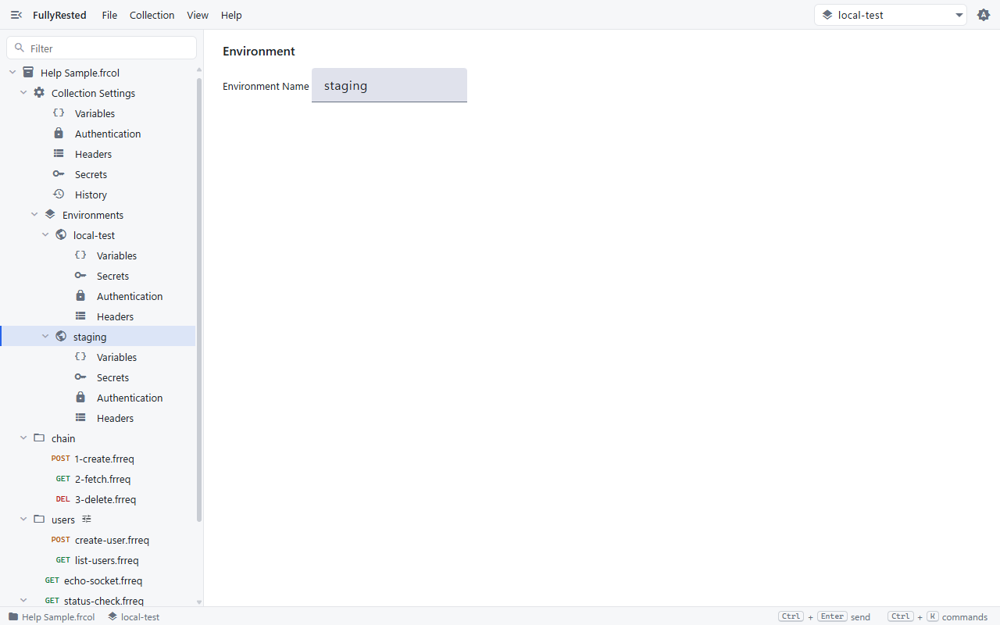
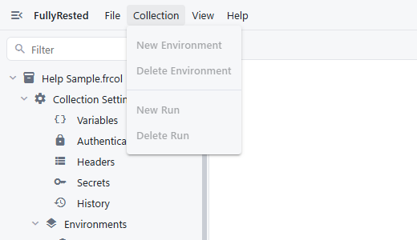
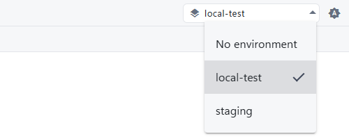

# Collections and environments

A collection holds settings shared by all its requests, plus named environments such as local-test and staging that you switch between with one click. This guide shows where those settings live and how they combine.

## What each level holds

A collection (the `.frcol` file) and each environment hold the same four kinds of setting: variables, secrets, authentication and headers. Folders and requests add to them, and the most specific level wins. The order is **run, request, folders, selected environment, collection**. Authentication set to `inherit` falls through to the next level.

| Level | Typical use |
|---|---|
| Collection | Values that rarely change, such as `host` for the API you test |
| Environment | Values that differ per target: base URLs, test accounts, tokens |
| Folder | Settings for one group of requests (see [Folders and hierarchy](03-folders-and-hierarchy.md)) |
| Request and run | Anything specific to one call or one variant of it |

## Edit collection settings

1. In the explorer, expand **Collection Settings**.
2. Click **Variables**, **Authentication**, **Headers** or **Secrets**. The editor shows that table, labelled "Collection".
3. Add a row in the empty line at the bottom, or untick a row's checkbox to switch it off.

Use a variable anywhere as `{{name}}`, as in `{{host}}/status/200`. Secrets are used as `{{$name}}` and are covered in [Variables and secrets](04-variables-and-secrets.md).

**History** under Collection Settings lists past runs; see [Runs and suites](08-runs-and-suites.md).

## Create and edit environments

1. Choose **Collection > New Environment**. The Collection menu items are greyed out until the matching thing is selected in the explorer.
2. Click the new environment in the explorer to rename it in the **Environment Name** field.
3. Expand it and open its **Variables**, **Secrets**, **Authentication** or **Headers** to fill them in.
4. To remove one, select it and choose **Collection > Delete Environment**.

## Select the active environment

Use the picker at the right of the toolbar. It lists **No environment** and every environment in the collection.

The selected environment is used when you send a request, and its name is shown in the status bar at the bottom. Its values override the collection's for any name they both define. Choose **No environment** to use the collection values only. After changing the selection, use **File > Save Collection** to keep it.

To see where a request's values come from, expand **Inherited** at the bottom of the request. Each row shows the kind, name, value and the level it came from, and overridden rows are marked.

## Next

- [Folders and hierarchy](03-folders-and-hierarchy.md)
- [Variables and secrets](04-variables-and-secrets.md)
- [Authentication](05-authentication.md)

See also [Concepts in the main README](../../README.md#concepts) and, for building collections from the command line, [Editing a collection](../../README.md#editing-a-collection).
