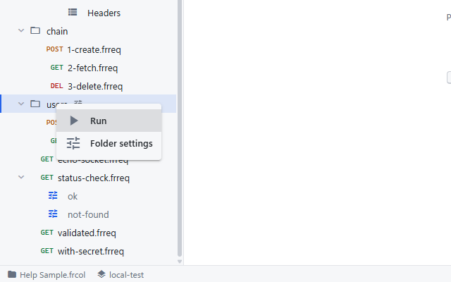
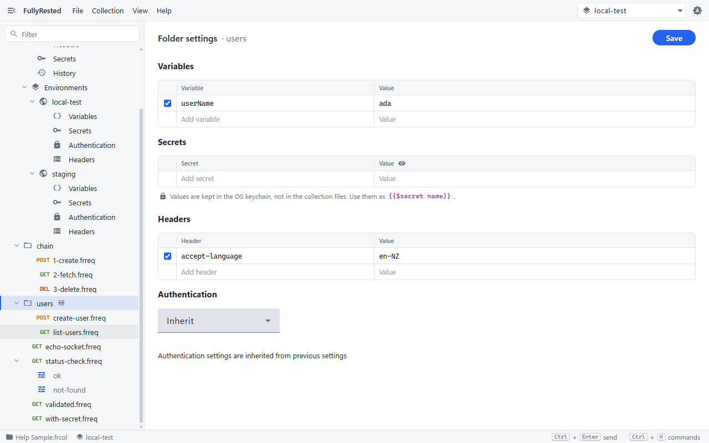
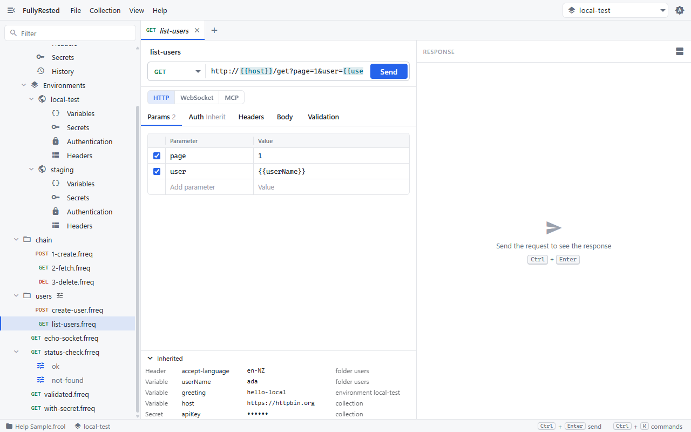
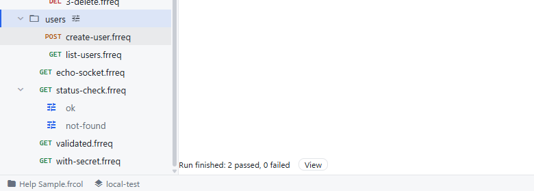

# Folders and the settings hierarchy

Use this guide to share headers, variables, secrets and authentication across a group of requests by putting them on a folder, and to see exactly which level each value comes from.

## How settings are layered

Every request is sent with settings gathered from several levels. When two levels set the same thing, the most specific one wins:

**run > request > folders > selected environment > collection**

- A folder can sit inside another folder. Nearer folders win over farther ones.
- Headers merge by name, ignoring case. A header set on a folder and a different header on the request are both sent. If both set `accept-language`, the more specific value is sent and the other is dropped.
- Variables and secrets work the same way: the nearest definition of `{{name}}` or `{{$name}}` is used.
- Authentication is either a real type (Basic, Bearer token, AWS Signature V4), `Inherit` or `None`. `Inherit` passes the question up to the next level. `None` stops the search, so the request is sent with no authentication even if a folder or the collection defines some.

## Edit a folder's settings

1. In the explorer, right-click the folder (here, `users` in the Help Sample collection). The menu offers **Run** and **Folder settings**.

   

2. Choose **Folder settings**. The editor opens with the folder's own Variables, Secrets, Headers and Authentication.

   

3. Add or change rows. In the sample, `users` defines the variable `userName` = `ada` and the header `accept-language: en-NZ`. Every request below the folder can use `{{userName}}` and is sent with that header.
4. Click **Save**. Folders that have settings show a small sliders icon beside their name in the explorer.

The settings are stored in a `folder.frfolder` file inside the folder. Authentication here is `Inherit`, so requests in the folder pick up whatever the next level up provides. Change it to `None` to switch authentication off for everything below the folder.

## See what a request inherits

1. Open a request below the folder, for example `list-users`.
2. At the bottom of the request editor, click **Inherited** to expand the panel. Runs have the same panel.
3. Read the table. Each row is a header, variable, secret or authentication setting the request gets from above, with the level it comes from in the last column.

   

A row that is struck through and faded has been overridden by a more specific level, so it is not used. Secret values are never shown, only dots. The panel lists only what comes from above, so anything defined on the request itself appears in its own tabs instead.

To change the source of a value, edit that level: the folder in step 2 above, an environment under **Environments** in the explorer, or the collection's own Variables, Secrets, Headers and Authentication.

## Run a folder

1. Right-click the folder and choose **Run**. Every request under it (including sub-folders) is sent using the selected environment, with its runs.
2. Watch the status line above the status bar count progress, then show the result, for example "Run finished: 2 passed, 0 failed". Click **Cancel** while it is running to stop early.

   

3. Click **View** to open the run record in the History view. Right-clicking the collection's root row and choosing **Run** does the same for everything.

If the folder holds nothing to run you see "Nothing to run in this folder".

## Next

- [Runs and suites](08-runs-and-suites.md) covers run records and re-checking them.
- [Variables and secrets](04-variables-and-secrets.md) covers `{{name}}` and `{{$name}}` in detail.
- [Authentication](05-authentication.md) covers each auth type.

## See also

- [Collections and environments](02-collections-and-environments.md) for the two levels above folders.
- [README: Folder settings](../../README.md#folder-settings) and [Command-line runner](../../README.md#command-line-runner) for `--folder <path>` and the CLI.
