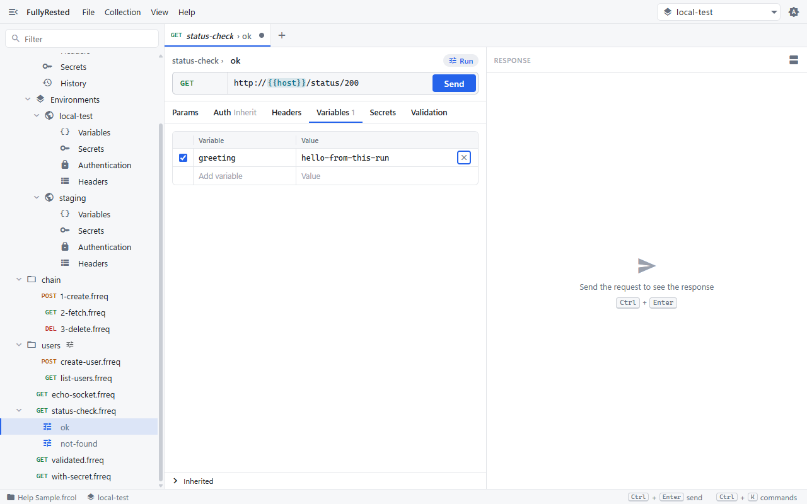
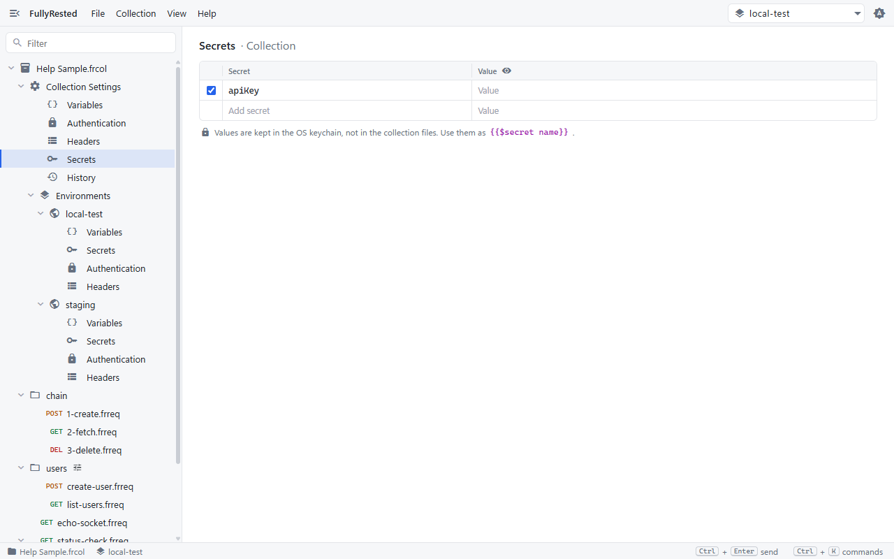
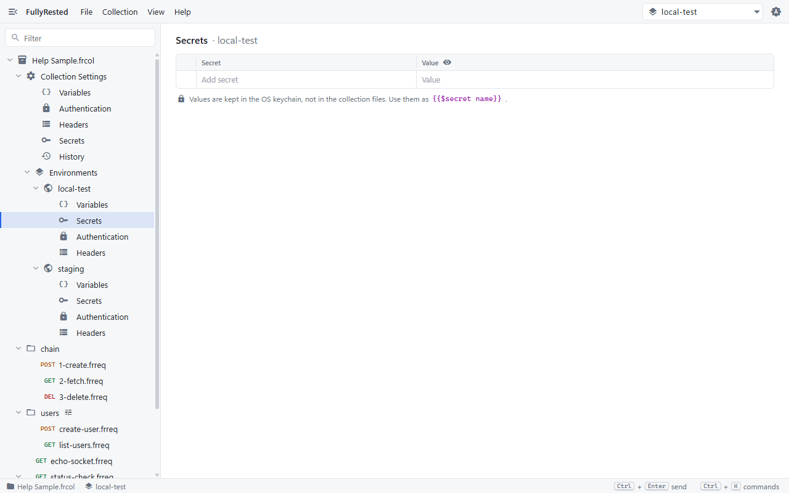
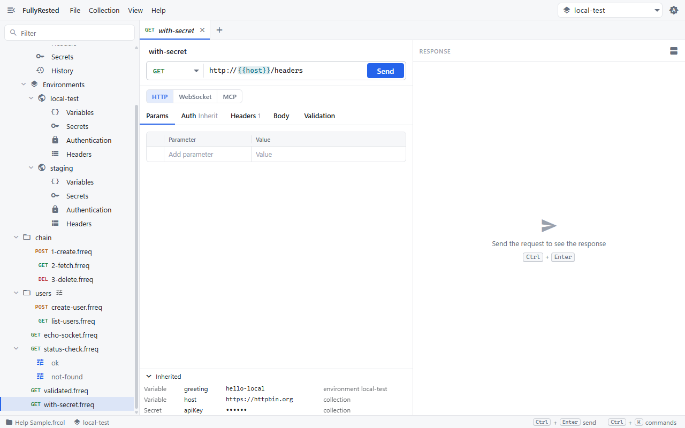
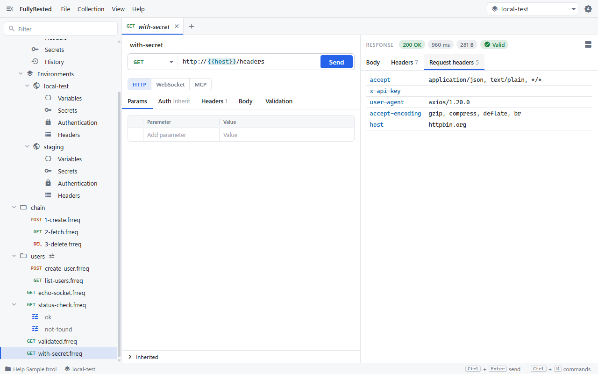

# Variables and secrets

Use variables to keep values like a host name out of every request, and secrets to keep passwords and API keys out of your files and your git history.

## Variable or secret?

| You write | It is | Where the value lives |
|---|---|---|
| `{{host}}` | a variable | In the collection, environment, folder, request or run file, in plain text |
| `{{$apiKey}}` | a secret | In your operating system's keychain. The file holds only the name |
| `{{$guid}}`, `{{$timestamp}}` | built-in | Generated fresh each time you send |

Both forms work in URLs, headers, parameters, bodies, authentication fields and validation.

## Where you can define them

The most specific level wins: **run, then request, then folders, then the selected environment, then the collection**. Define a value once at a wide level and override it only where it differs.

| Level | How to open it |
|---|---|
| Collection | In the explorer, expand **Collection Settings** and pick **Variables** or **Secrets** |
| Environment | Expand **Environments**, expand an environment, pick **Variables** or **Secrets** |
| Folder | Right-click the folder, then **Folder settings** (it has Variables and Secrets sections; a folder with settings shows a small tune icon) |
| Run | Open a run under a request and use its **Variables** and **Secrets** tabs |

## Add a variable

1. In the explorer, expand **Collection Settings** and click **Variables**.
2. Type a name in the **Variable** column and a value beside it, in the empty "Add variable" row.
3. Use it as `{{name}}` anywhere in a request. The sample collection already defines `host` as `https://httpbin.org`, so a URL of `{{host}}/headers` works.

Tick or untick the box at the start of a row to switch a variable on or off. Environments are the usual place for values that change between targets, such as `greeting` in the sample's `local-test` and `staging` environments (see [Collections and environments](02-collections-and-environments.md)). A run can override any of them for one case:

## Add a secret

1. Click **Secrets** under **Collection Settings** (or under an environment, or the Secrets tab of a run).
2. Type the secret's name in the **Secret** column, for example `apiKey`.
3. Type its value in the **Value** column. Click the eye icon in the column header to show or hide values.
4. Use it as `{{$apiKey}}`.

Environments have their own Secrets panel, so each can hold a different key:

A secret name may use letters, digits, `-` and `_`. A name with a dot or a space is accepted but never substituted.

## Where a secret's value goes

- The value is stored in the OS keychain, never in the `.frcol`, `.frreq` or `.frfolder` file.
- The file holds only a reference, for example `"$secret": "apiKey"`, plus whether it is active.
- Run records and everything an AI agent sees have secret values redacted.

What that means for git: you can commit the whole collection safely. A teammate who clones it gets the reference `apiKey` with no value, so they open **Secrets**, type their own value, and it goes into their own keychain. On CI, set an environment variable named `FULLYRESTED_SECRET_<NAME>` instead; see the [CLI section of the README](../../README.md#command-line-runner).

## Built-ins

`{{$guid}}` is a fresh UUID and `{{$timestamp}}` is the current time in epoch milliseconds. You do not declare them. One request sees the same value everywhere (URL, body, validation); the next send gets a new one. A secret you declare with the same name takes precedence. They also work inside a variable's value, so a run can set `tagName` to `api-{{$guid}}` for a unique name each time.

## Use both in a request

Open `with-secret.frreq` from the sample collection. Its URL is `{{host}}/headers` and it sends the header `x-api-key: {{$apiKey}}`.

1. Click **with-secret.frreq** in the explorer.
2. Expand **Inherited** at the bottom of the request pane. It lists every variable and secret this request can see, which level each comes from, and shows secrets masked.

   

3. Press **Send** (or Ctrl+Enter).

## See the resolved value

After sending, open the **Request headers** tab beside the response. It shows what was actually sent, with `{{host}}` replaced by the real host. The `x-api-key` row is empty here because no value has been entered for `apiKey` yet; type one in **Secrets** and send again to fill it.

If a name does not resolve, check it in **Inherited** first: a typo in the name, a variable turned off, or a secret with no value are the usual causes.

## Next

- [Authentication](05-authentication.md) puts secrets into basic, bearer and AWS sign-in.
- [Capturing values](07-capturing-values.md) fills variables from one response for the next request.
- [Folders and hierarchy](03-folders-and-hierarchy.md) covers folder-level settings.
- See also the README sections [Secrets, end to end](../../README.md#secrets-end-to-end) and [Unique values and runs-only requests](../../README.md#unique-values-and-runs-only-requests).
