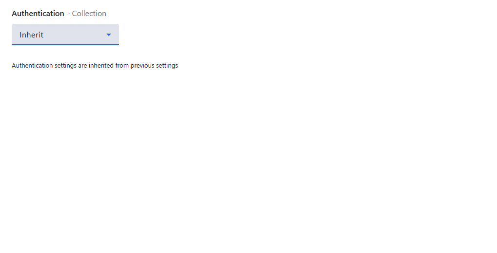
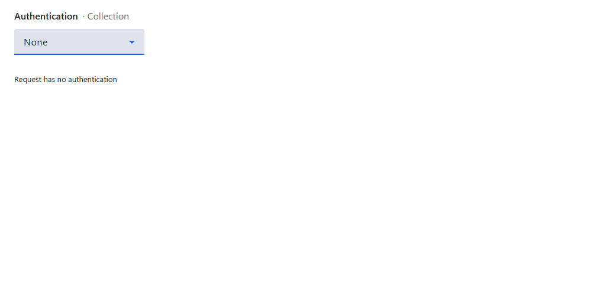
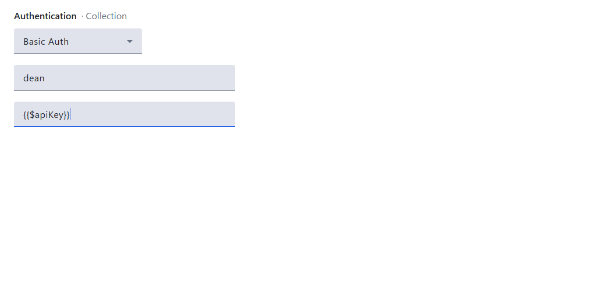
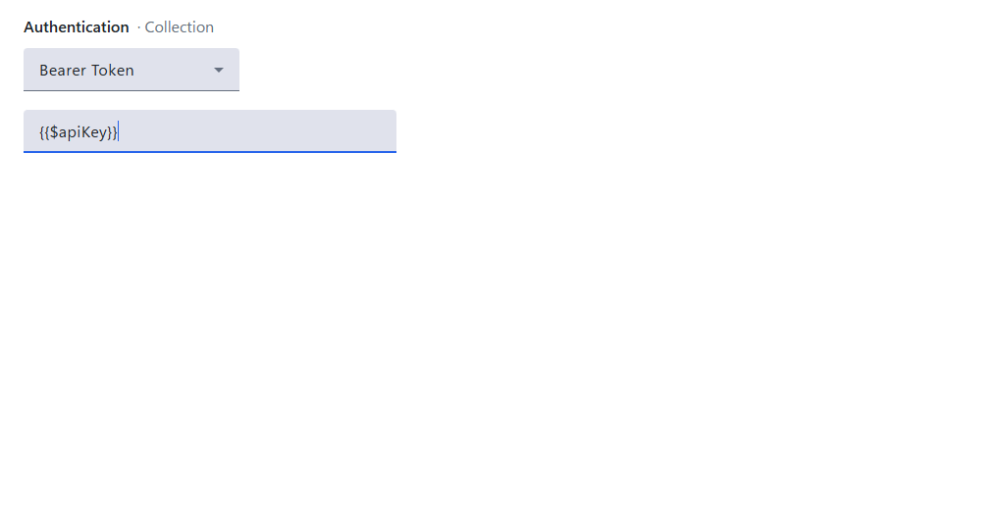
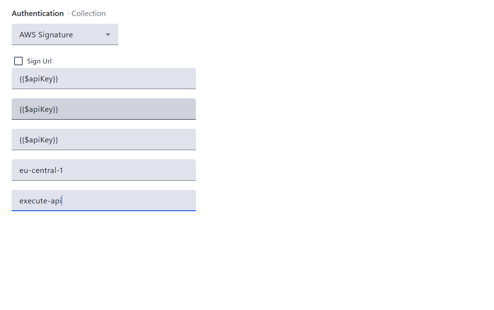
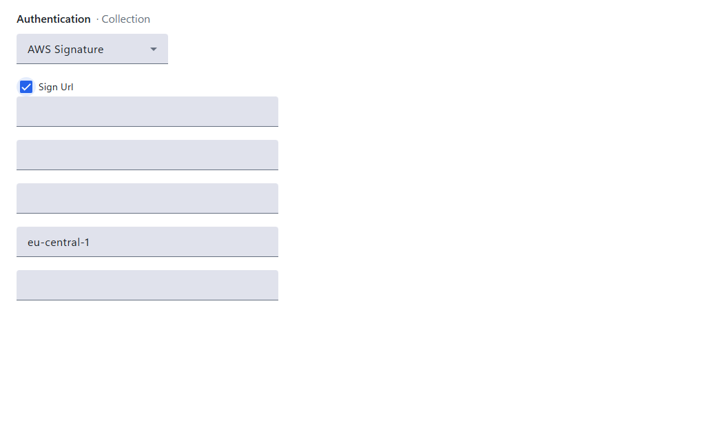
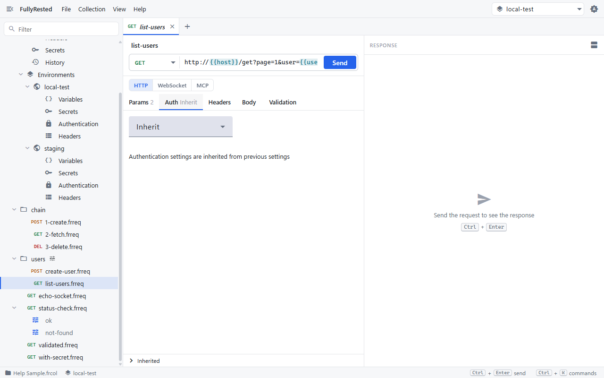
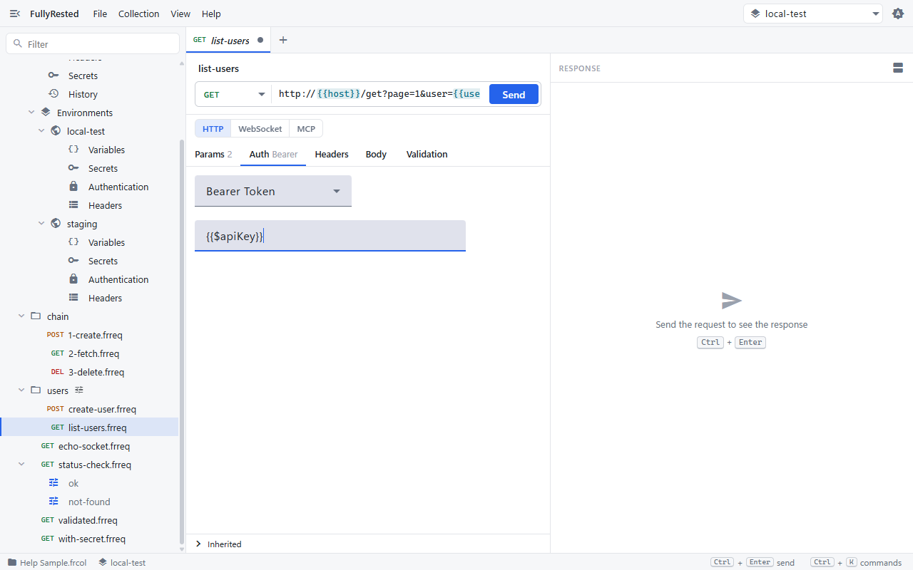

# Authentication

Authentication tells FullyRested how to prove who you are to the server: you set it once at the level that suits, and every request below it picks it up.

## The types

Every auth editor starts with a method list. The choices are:

| Method | What it sends |
|---|---|
| **Inherit** | Nothing of its own. The request uses the next level up |
| **None** | No authentication, and the search for one stops here |
| **Basic Auth** | A user name and password, sent as an `Authorization: Basic` header |
| **Bearer Token** | A token, sent as `Authorization: Bearer <token>` |
| **AWS Signature** | An AWS Signature V4 signature, from an access key and secret key |

## Where you set it

Auth can be set at five levels: the collection, a selected environment, a folder, a request and a run. In the explorer, expand **Collection Settings** and click **Authentication** for the collection, or expand an environment under **Environments** and click its **Authentication**. For a folder, right-click it and choose **Folder settings**. For a request, open it and use its **Auth** tab.

## Set collection-wide authentication

1. In the explorer, under **Collection Settings**, click **Authentication**. The pane title reads "Authentication · Collection".
2. Open the method list and choose a method.
3. Fill in the fields it shows, as described below.
4. Save the collection (**File > Save Collection**) when you are done.

New settings start as **Inherit**, which at the collection level means no authentication is added.

### None

Choose **None** to say that requests below this point send no auth. See "How the levels combine" for why this differs from Inherit.

### Basic Auth

Enter a **User Name** and then a **Password**, in the two fields in that order. The password should be a secret reference, as in the screenshot.

### Bearer Token

Enter the **Token** in the single field. The same editor appears on a request's **Auth** tab.

### AWS Signature

Fill in the fields in this order: **AccessKey**, **SecretKey**, **SessionToken**, **AWS Region** and **Service Name**. Leave SessionToken empty for long-term keys. For temporary credentials, such as those from an assumed role, put the session token there (the field is labelled "SessionToken (temporary credentials)").

By default the signature goes in the request headers. Tick **Sign Url** to sign the URL itself instead (a presigned URL), which is what you want when the call will be made by something that cannot set headers.

## Set authentication on one request

1. Open the request and click its **Auth** tab. The tab shows the current method beside its name, for example "Auth Inherit".
2. Choose a method and fill in its fields, exactly as for the collection.

A request set to Bearer Token with a secret reference looks like this, and the tab now reads "Auth Bearer":

A run (a named variant of a request) can override auth too, so one request can be tried with different credentials.

## How the levels combine

The most specific level wins, in the order **run, request, folders, selected environment, collection**. FullyRested starts at the run and works up:

- **Inherit** hands the decision to the next level up.
- **None** stops the search: no auth is sent, even if a folder or the collection defines some.
- Any other method is used as it stands, and the search stops.

So a typical setup is a bearer token on the collection, Inherit everywhere else, and **None** on the one request (a health check, say) that must go out bare. See [Folders and hierarchy](03-folders-and-hierarchy.md) for how folder settings stack, and [Collections and environments](02-collections-and-environments.md) for environment-level settings.

## Keep credentials out of the file

The password, token, access key, secret key and session token fields should hold a secret reference such as `{{$apiKey}}`, never the value itself. The value lives in your OS keychain, and only the reference is saved in the collection file. If you type a literal into one of these fields, the editor warns "Saved in plain text — use a {{$secret}} reference". Follow [Variables and secrets](04-variables-and-secrets.md) to declare the secret and give it a value, then type `{{$name}}` into the field.

## Tokens for WebSocket requests

A WebSocket request uses the same auth as an HTTP request, applied to the handshake. Some servers cannot read a header on a WebSocket connection and expect the token in the query string instead. Bearer Token auth has a `placement` for this: `header` (the default) or the name of a query parameter such as `token`. The token is URL-encoded into the connect URL, and run records and errors show the URL without it.

The editor has no placement field yet. Set it in the request file (`"placement": "token"` inside `authentication`) or with the CLI or agent `set-auth` verb. The README shows an example under [WebSocket requests](../../README.md#websocket-requests).

## Next

- [Validation](06-validation.md)
- [Variables and secrets](04-variables-and-secrets.md)
- See also: [Editing a collection from the CLI or an agent](../../README.md), which covers `set-auth` and `secret set`.
