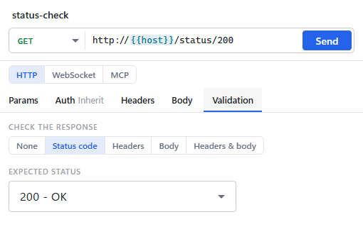
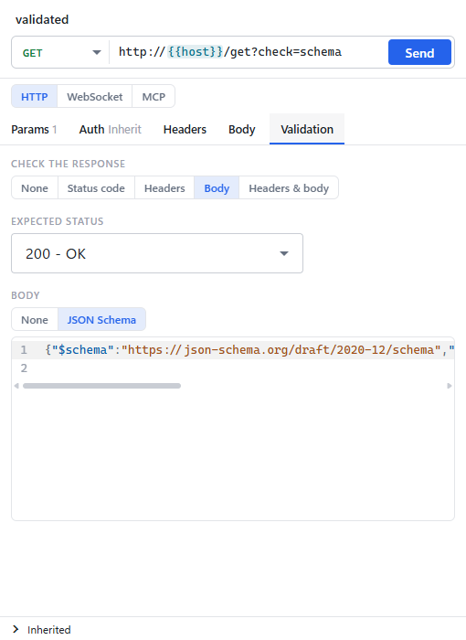
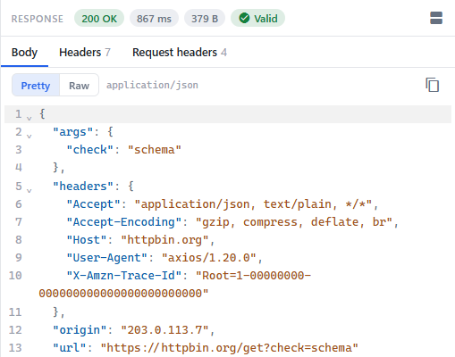
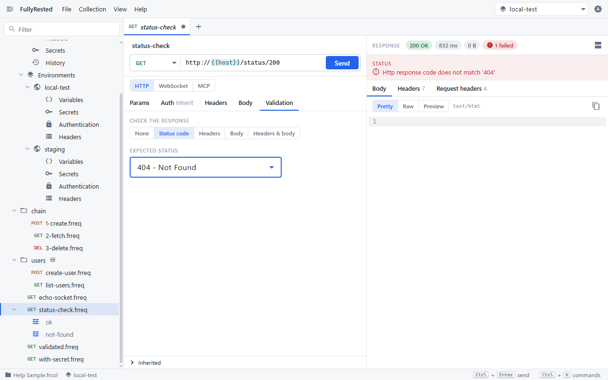
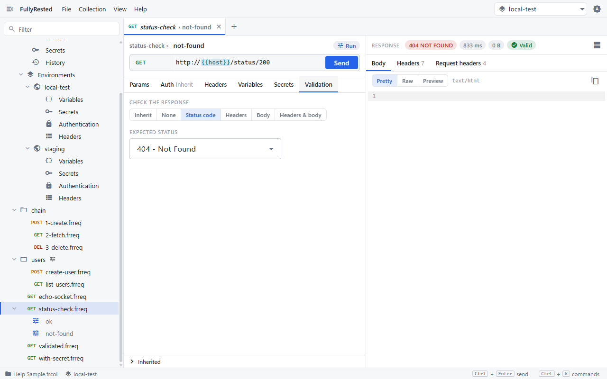

# Validation

Validation turns a request into a test: FullyRested sends it, then checks the status code, the response headers and the shape of the JSON body, and marks the result as valid or failed.

You set validation on the **Validation** tab of a request or of one of its runs. The sample collection has two requests to try: `validated` (checks a JSON Schema) and `status-check` (checks status codes).

## Expect a status code

1. Open `status-check.frreq` from the explorer and select the **Validation** tab.
2. Under **Check the response**, choose **Status code**.
3. Pick the code you expect from the **Expected status** list, for example `200 - OK`.

The other choices are **None** (no check), **Headers**, **Body** and **Headers & body**. On a run there is also **Inherit**, which uses the request's validation.

## Check response headers

1. On the Validation tab, choose **Headers** (or **Headers & body**).
2. Under **Expected headers**, add a row for each header you want to see, with its expected value.

Header names are matched without regard to case. Variables such as `{{name}}` can be used in the values.

## Check the body with a JSON Schema

1. Choose **Body** (or **Headers & body**).
2. Under **Body**, switch from **None** to **JSON Schema**.
3. Write the schema in the editor. `validated.frreq` uses one that requires an object with a string `url` and an object `args`.

A schema describes the structure you rely on, not every value. Mark the fields you depend on as `required` and give each a `type`.

## Read a passing result

Press **Send** (or `Ctrl+Enter`). When every check passes, a green **Valid** pill appears next to the status, time and size above the response.

## Read a failing result

When a check fails, the pill turns red and says how many failed (for example `1 failed`), and a red panel above the response names each failed check and why. In this shot the expected status of `status-check` was changed to `404` (without saving) while the server answered `200`.

The response is still shown in full, so you can compare it with what you expected. A body that fails the schema is listed the same way, one line per schema error.

## Expect an error status in a run

A request that returns `404` on purpose is a fine test. Put the expectation on a run, which can override the request's validation:

1. Open `status-check.frreq` and select its run `not-found` in the explorer.
2. On the Validation tab, the run expects `404 - Not Found`.
3. Press **Send**. The server answers `404 NOT FOUND` and the result is **Valid**, because that is what the run asked for.

Use this for negative cases: one run per status you want to prove, such as a `401` without a token or a `404` after a delete. See [Runs and suites](08-runs-and-suites.md) for running them together.

## Build a schema from a real response

The desktop app has no button that generates a schema; you write it in the editor. Command line and agents can generate one for you from a recorded run: `validation-from-case` (CLI) and `validation_from_case` (MCP) read a case you have already run and write the status it saw plus a JSON Schema inferred from its body. The inferred schema fails on regressions, not growth: `required` lists the fields the sample had, and a field the API adds later does not fail the check. Open the request in the app afterwards and tighten the schema by hand.

For the exact command and its options, see [Edit verbs](../../README.md) in the README (search for `validation-from-case`).

## Next

- [Capturing values](07-capturing-values.md): pass a value from one response into the next request.
- [Runs and suites](08-runs-and-suites.md): run many validated requests at once.

See also: [Variables and secrets](04-variables-and-secrets.md), [Collections and environments](02-collections-and-environments.md).
