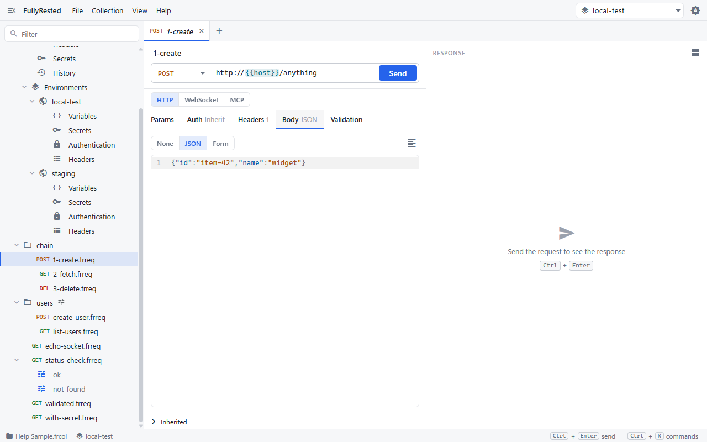
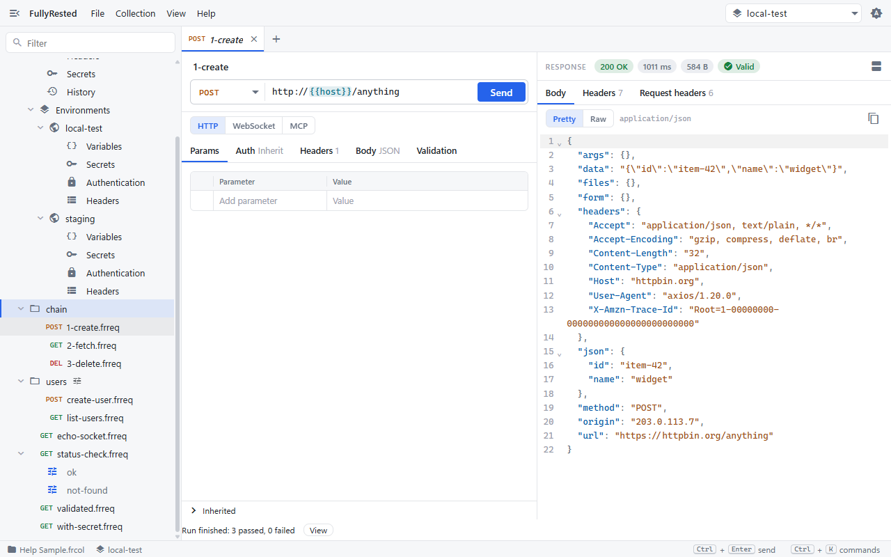

# Using a value from a previous call

Use a capture rule when one request creates something (an id, a token, a url) and a later request in the same run needs that value.

A capture rule says: after this request is sent, read one value out of its response and hold it in a `{{variable}}`. Every request that runs after it in the same run can use that variable like any other.

## How it looks in the sample collection

The sample collection has a `chain` folder with three requests:

| Request | What it does |
|---|---|
| `1-create` | `POST {{host}}/anything` with the body `{"id":"item-42","name":"widget"}`. Its capture rule reads `$.json.id` from the response into `itemId` |
| `2-fetch` | `GET {{host}}/anything/{{itemId}}` |
| `3-delete` | `DELETE {{host}}/anything/{{itemId}}` |

httpbin's `/anything` echoes the request back, so the response holds the body you sent under `json`. That is why the path is `$.json.id`.



Capture rules are not shown in the request editor yet. You set them in the request file, with `fullyrested edit set-capture`, or through an agent (the MCP `set_capture` tool). See [Capturing a value from one response for later requests](../../README.md#capturing-a-value-from-one-response-for-later-requests) for the exact commands.

## Set a rule

1. Choose where to read the value from:
   - `body` takes a JSONPath such as `$.id` or `$.items[0].guid` (the first match).
   - `header` takes a header name, matched without regard to case.
   - `status` takes no path and captures the status code.
2. Give the variable a name, for example `itemId`.
3. Use `{{itemId}}` in the url, headers, body or auth of any request that runs later.

```
fullyrested edit set-capture -c "Help Sample.frcol" --scope request:chain/1-create.frreq --name itemId --from body --path '$.json.id'
```

A captured value beats a variable of the same name set anywhere else (collection, environment, folder or run). It lives only for that run and is never written to a variable table. A rule on a request applies to each of its runs, and a run's own rule for the same variable replaces the request's.

## Run the chain from the app

1. In the sidebar, right-click the `chain` folder and choose **Run**.
2. Wait for the status line under the editor to read **Run finished: 3 passed, 0 failed**.



All three cases passed because `2-fetch` and `3-delete` were sent to `/anything/item-42`. Sent on its own, `2-fetch` would have nothing to read `{{itemId}}` from; capture only works inside a run (a folder run, a collection run, or `fullyrested run`). Sending one request alone has no earlier request to capture from.

## Order matters

Requests in a folder run in tree order, so name the files to put the creating request first: `1-create`, `2-fetch`, `3-delete`. A later capture of the same name replaces the earlier one, and the request in between sees the newer value. That lets one run hold several create and delete pairs.

## Setup and cleanup inside the run

You do not need a separate setup step or a fixture. Put the create first, capture its id, and let the later requests use it. The run then owns its test data from start to finish:

- Setup: the first request creates the thing and captures its id.
- Test: the middle requests read, change or validate it with `{{itemId}}`.
- Cleanup: a trailing request deletes `{{itemId}}`. A `DELETE` that succeeds only once is fine, because the create right before it supplies a fresh one. A second `DELETE` of the same id that expects 404 proves the first one worked.

## When a rule finds nothing

If the path, header or JSON body is not there, the request's case ends as an `error` that names the rule, so you can see which capture failed. The run record lists the variable names each case captured, never their values.

## Next

- [Runs and suites](08-runs-and-suites.md) for running folders and collections and reading the results.

## See also

- [Variables and secrets](04-variables-and-secrets.md) for the other places a `{{variable}}` can come from.
- [Validation](06-validation.md) to check each response in the chain.
- [WebSockets](09-websockets.md): websocket cases read captured values but do not capture.
- [README: capturing a value](../../README.md#capturing-a-value-from-one-response-for-later-requests) and [setup inside the run](../../README.md#setup-inside-the-run-empty-bodies-and-cleanup) for CLI and agent detail.
