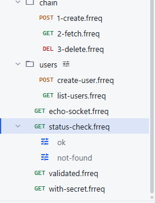
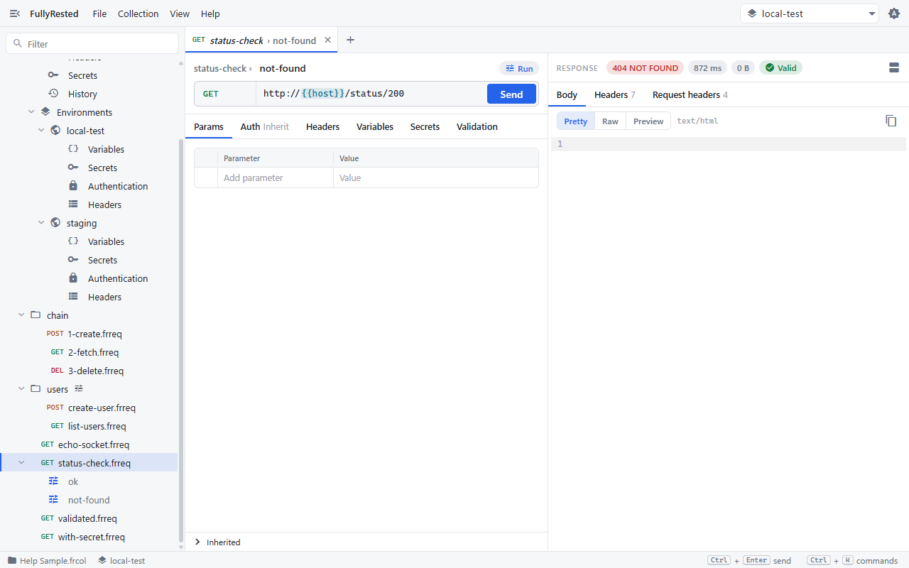
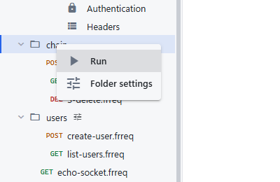
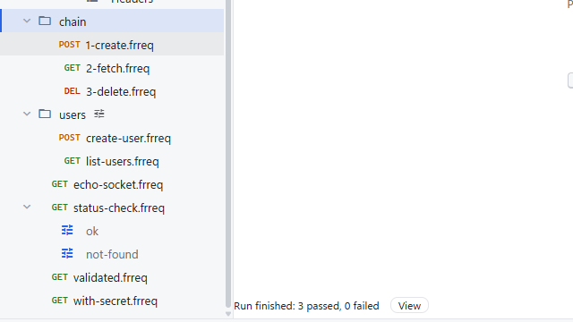
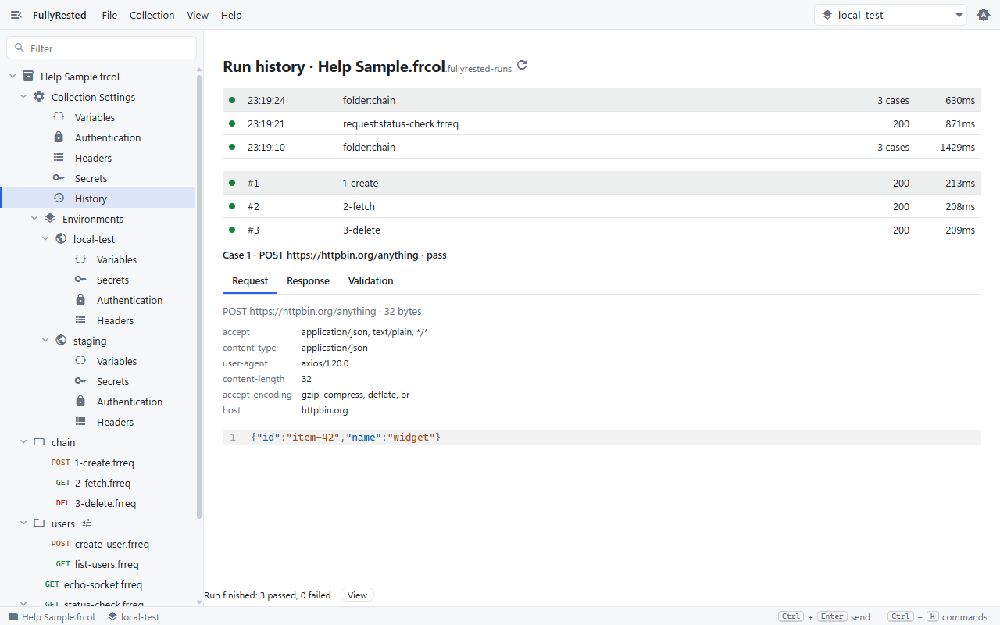

# Runs and running a collection

Use runs to test one endpoint several ways, and run a folder or the whole collection to check many requests in one go.

## Runs: named variants of a request

A run is a named variant of a request. It starts from the request and overrides parts of it: variables, secrets, headers, parameters, authentication and validation. In the sample collection, `status-check` has two runs. `ok` expects a 200. `not-found` points the URL at `/status/404` and expects a 404.

Runs appear as children of their request in the sidebar.

### Add a run

1. Select the request in the sidebar.
2. Open the **Collection** menu and choose **New Run**. (Right-clicking the request also offers **New run**.)
3. Type a name in the run's title field, for example `not-found`.
4. Fill in only what differs from the request: parameters, headers, variables, secrets, authentication or validation. Anything you leave alone is inherited from the request.

To remove a run, select it and choose **Collection > Delete Run**.

### Send a run

1. Click the run in the sidebar. It opens in its own tab, titled `status-check > not-found`.
2. Click **Send** (or press Ctrl+Enter).
3. The response pane shows the status, the time and the validation verdict for that run.

Here the response is a 404 and the badge says **Valid**, because this run expects a 404. The same request sent bare would fail its own 200 rule.

Each request and each run keeps its latest result. Close the tab and reopen it, or switch between tabs, and the response is still there.

## Run a folder or the whole collection

1. Right-click a folder, or the collection root at the top of the sidebar.
2. Choose **Run**.

Everything beneath it runs one request at a time. A request with runs is tested through its runs; a request with no runs is sent as it is.

While it runs, a status line at the bottom of the window reads `Running 2 of 3`, with a count of passed and failed cases and a **Cancel** button. Cancel stops after the current request.

When it ends, the line reads `Run finished: 3 passed, 0 failed`, or `Run cancelled after 2 of 3`. Click **View** to open the run history.

The result of each request also lands in its own tab, so you can open a failing request and see exactly what it sent and received.

### Runs-only requests

A request can be marked runs-only, so a folder or collection run tests only its runs and never sends the bare request. This is for a DELETE or update whose bare form would destroy shared data. The desktop app has no toggle for it yet: set it from the CLI or an agent with `set-runs-only`, described in the [README](../../README.md) under "Unique values and runs-only requests".

## Run history

Every send and every folder or collection run from the app is recorded in the collection's `.fullyrested-runs` folder. Open the list in any of these ways:

- Select **History** under **Collection Settings** in the sidebar.
- Choose **View > Run history**.
- Press Ctrl+K and pick it from the command palette.

Each row shows the time, what was run (`request:`, `folder:` or `run:` followed by the name), the status or case count, and the duration. A green dot means everything passed and a red dot means a check or the request failed. Rows from the command line or an agent carry a `cli` chip. Select a row to see its cases, and for each case the Request, Response and Validation tabs. The refresh button reloads the list. The app keeps its newest 200 records.

History is a folder of files, so it is worth adding `.fullyrested-runs/` to your `.gitignore`.

## Run from the command line

For CI, the CLI runner does the same job without the app: `fullyrested run -c <collection> --all` runs everything and exits non-zero on a failure. The options, exit codes and the `--record` flag are in the [README](../../README.md), and records it writes show up in the History pane too.

## Next

- [Capturing values](07-capturing-values.md) to feed one response into the next request.
- [WebSockets](09-websockets.md) for requests that run in a suite beside HTTP ones.
- [Shortcuts and more](10-shortcuts-and-more.md).

See also [Validation](06-validation.md), which decides whether each run passes, and [Collections and environments](02-collections-and-environments.md).
