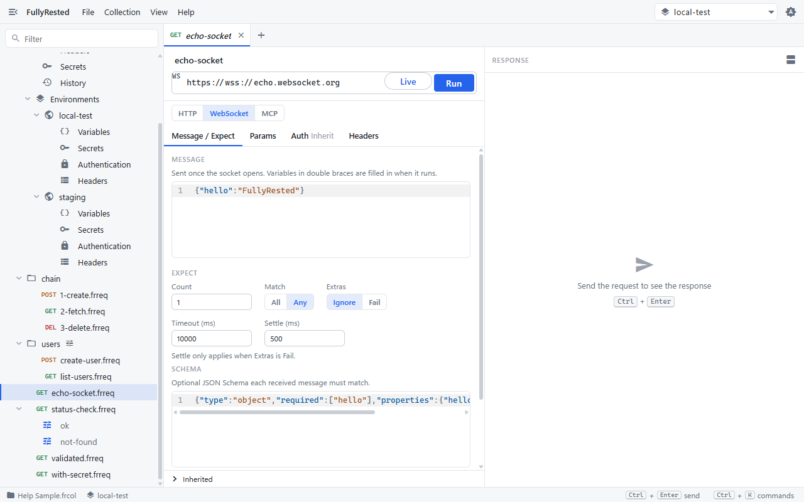
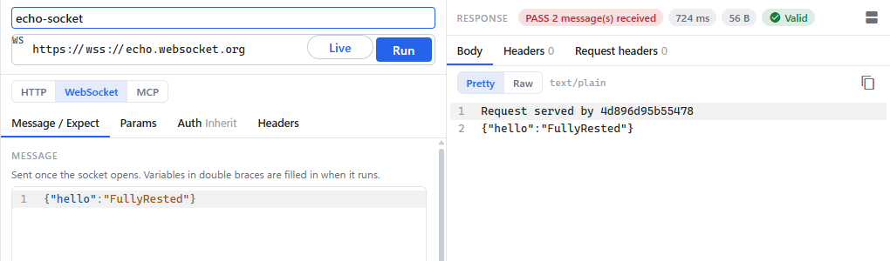
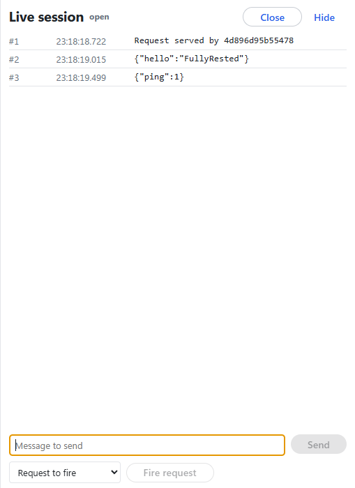
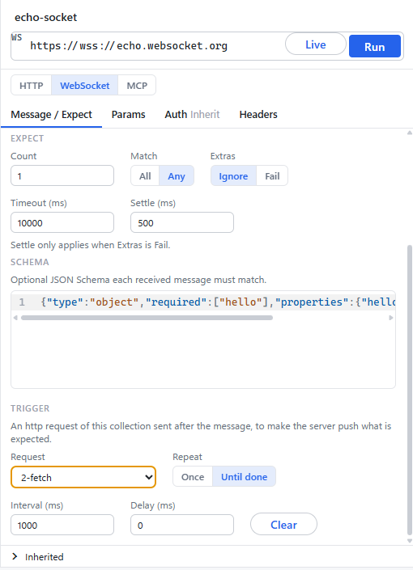

# WebSockets

Use a websocket request to open a socket, send one message, and check what the server sends back, either as a bounded test that passes or fails, or as a live session you watch and type into.

The sample collection has one: `echo-socket.frreq`, which talks to `wss://echo.websocket.org`.

## Create or open a websocket request

1. In the explorer, open **echo-socket.frreq**. To make your own, open any request and switch the **HTTP / WebSocket / MCP** toggle under the URL bar to **WebSocket**. The method picker becomes a `WS` badge, and the URL takes a `ws://` or `wss://` address.
2. On the **Message / Expect** tab, put the text frame to send in **Message**. It is sent once, when the socket opens, and `{{variables}}` and `{{$secrets}}` are filled in as for HTTP.
3. Headers, auth, params and folder or environment inheritance work as for HTTP; headers and auth go on the connection handshake. Binary frames are not supported.

## Say what you expect

The **Expect** section decides when the test passes.

- **Count**: how many messages to wait for (default 1).
- **Match**: with **All**, each of the first `count` messages must match the schema and a mismatch fails at once. With **Any**, one matching message is enough, and earlier non-matching ones are counted as extras.
- **Schema**: an optional JSON Schema that every message is checked against. A message that is not JSON never matches.
- **Extras**: **Ignore** (default) or **Fail**. An extra is a message past the count, or a mismatch under Any.
- **Timeout (ms)**: the overall limit (default 5000; the sample uses 10000).
- **Settle (ms)**: how long to keep listening after a pass to catch a late extra. It only applies when Extras is **Fail**.

echo.websocket.org sends a plain-text greeting ("Request served by ...") before it echoes your message. That greeting is not JSON, so the sample uses **Match: Any** with a schema that requires `hello`: the greeting is skipped as an extra and the echo of your message passes.

## Run a bounded test

1. With the request open, press **Run** (or Ctrl+Enter).
2. FullyRested connects, sends the message, checks what arrives against Expect, and closes the socket.
3. The response pane shows the outcome, the time, and every message received.

A run fails on a mismatch, a timeout, a close or a rejected handshake. It is recorded like any other case and can sit in a suite beside HTTP requests (see [Runs and suites](08-runs-and-suites.md)).

## Use a live session

A live session stays open until you close it, so you can watch traffic and send frames by hand. It keeps the newest 1,000 events in memory and writes nothing to disk.

1. Press **Live** beside **Run**. The **Live session** panel opens and shows **open** when connected. For a socket that is not in a request, type a URL into the panel's bar and press **Connect**.
2. Each message appears with a sequence number (`#1`, `#2`) and a time. Here the server greeting is `#1`, and the echo of the request's message is `#2`.
3. Type a frame into **Message to send** and press **Send** (or Enter). The echo arrives as the next event.
4. Press **Close** to end the session, or **Hide** to put the panel away.

## Put a token in the query string

A browser cannot set headers on a websocket, so some servers read the token from the URL instead. On a bearer-token request, `placement` is `header` (the default) or the name of a query parameter such as `token`. The token is URL-encoded into the connect URL, and run records, output and errors show the URL without it.

The app's **Auth** tab does not offer a placement control. Set it with `fullyrested edit set-auth` or the agent's `set_auth` (both take `placement`), or write it in the `.frreq` file. See [WebSocket requests](../../README.md#websocket-requests) for the field layout.

## Fire an HTTP request after the message (triggers)

Some servers only push a message after something else happens, such as an HTTP call that changes data. A trigger names an HTTP request in the same collection to send after your message.

1. Scroll to the **Trigger** section at the bottom of the **Message / Expect** tab.
2. Pick the **Request** to fire. Choosing **None** removes the trigger.
3. Optionally pick a **Run** of that request, choose **Repeat**, and set **Delay (ms)** and **Interval (ms)**. **Until done** (default) fires every interval until the test finishes, which avoids racing the server's subscription of your new socket. **Once** fires a single time. **Clear** removes the trigger.

Triggers fire only during **Run** (and the CLI and MCP runs), never in a live session. A failing trigger does not fail the test on its own; Expect decides. The response pane lists each firing under **Trigger calls**.

To send an HTTP request into a running live session by hand, use **Request to fire** and **Fire request** at the bottom of the Live panel.

## Next

- [Runs and suites](08-runs-and-suites.md) to run a websocket test with the rest of a collection.
- [Shortcuts and more](10-shortcuts-and-more.md).

## See also

- [Authentication](05-authentication.md) and [Variables and secrets](04-variables-and-secrets.md)
- [WebSocket requests](../../README.md#websocket-requests) for the CLI (`fullyrested ws watch`, `edit set-expect`, `edit set-trigger`) and the `ws_session_*` MCP tools.
