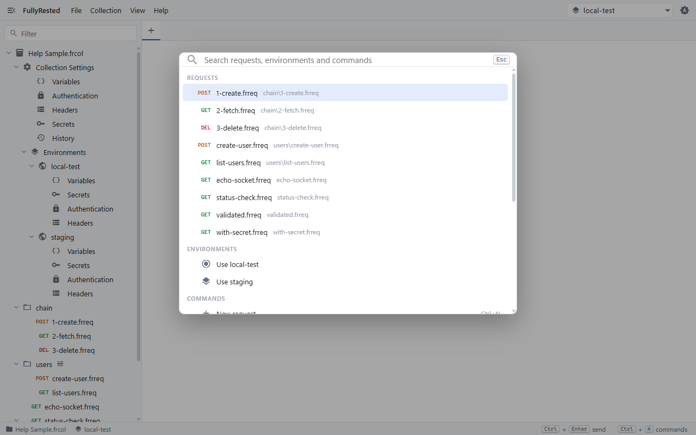
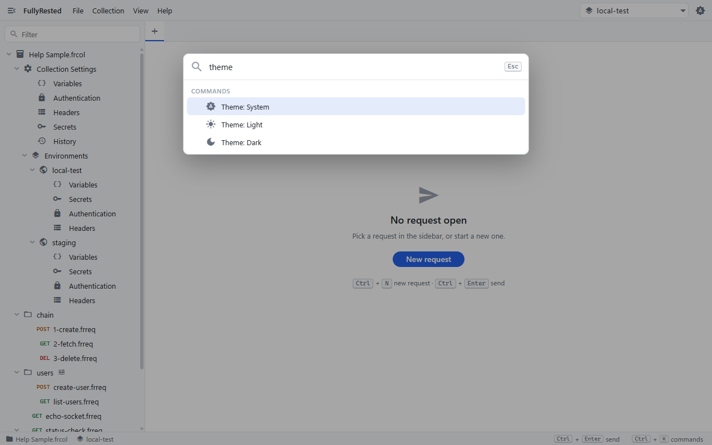
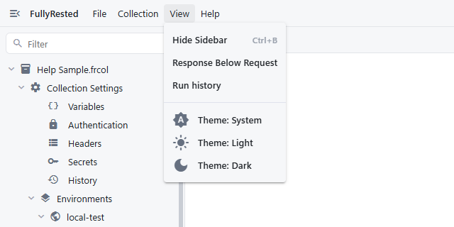

# Shortcuts, the command palette and more

This guide shows you the fastest ways around FullyRested: the command palette, the keyboard shortcuts, the View menu, and where to go for MCP requests, the command-line runner and AI agents.

## Use the command palette

The palette is one search box for opening requests, switching environments and running commands, without reaching for the mouse.

1. Press **Ctrl+Shift+P** (or **Ctrl+K**; use **Cmd** instead of **Ctrl** on macOS). You can also click the `Ctrl+K commands` hint in the bottom-right of the status bar. Pressing the shortcut again closes the palette.
2. Start typing. The list narrows as you type.
3. Use the **Up** and **Down** arrow keys to highlight a result and press **Enter** to run it. Press **Esc** to close the palette.

The palette lists:

- **Open tabs**: jump to a tab you already have open (shows "unsaved" if it has edits).
- **Requests**: every request in the open collection, with its method and folder path. Choosing one opens it.
- **Environments**: `Use <name>` for each environment, to make it the active one.
- **Commands**:
  - New request (Ctrl+N)
  - Save request (Ctrl+S)
  - Open collection... (Ctrl+O)
  - New collection...
  - Hide sidebar / Show sidebar (Ctrl+B)
  - Toggle response position
  - Help topics (F1)
  - Run history (only with a collection open)
  - Theme: System, Theme: Light, Theme: Dark
  - New environment (only with a collection open)

Commands that have a keyboard shortcut show it on the right of the row.

## Keyboard shortcuts

These work anywhere in the window, including inside the body editor. On macOS, use **Cmd** in place of **Ctrl**.

| Shortcut | What it does |
|---|---|
| Ctrl+Enter | Send the request in the active tab |
| Ctrl+S | Save the request |
| Ctrl+N | New request |
| Ctrl+O | Open a collection |
| Ctrl+W | Close the active tab |
| Ctrl+Tab | Go to the next tab |
| Ctrl+Shift+Tab | Go to the previous tab |
| Ctrl+B | Show or hide the sidebar |
| Ctrl+L | Put the cursor in the URL box of the active request |
| Ctrl+K or Ctrl+Shift+P | Open or close the command palette |
| F1 | Open Help (works with or without a collection open) |

You can also close a tab by middle-clicking it.

## Help

Press **F1**, or choose **Help > Help topics**, to read these guides inside FullyRested. It is the same set of pages as `docs/help` in the repository, and links to outside sites open in your web browser.

## The View menu

Open **View** in the top menu bar for layout and appearance options.

- **Hide Sidebar / Show Sidebar** (Ctrl+B): hide the collection tree to give the request more room.
- **Response Below Request / Response Beside Request**: switch the request and response panes between stacked and side by side.
- **Run history**: open the history of runs for the open collection (greyed out with no collection open).
- **Theme: System / Light / Dark**: follow your operating system, or force a light or dark look. The theme button at the top right cycles through them too.

## MCP requests

Besides HTTP and WebSocket, a request can be an MCP request: one JSON-RPC call to an MCP server, with the usual variables, secrets, auth, environments, runs and validation. The fields (method, params, handshake, expected outcome) are described in [MCP requests](../../README.md#mcp-requests) in the README.

## Command line and AI agents

- To run a collection, folder or request from a terminal or a CI job, use the command-line runner: see [Command-line runner](../../README.md#command-line-runner).
- To let an AI agent drive FullyRested, see [Using FullyRested from an AI agent](../../README.md#using-fullyrested-from-an-ai-agent).

## Next

- Back to the start: [Getting started](01-getting-started.md)

## See also

- [Collections and environments](02-collections-and-environments.md)
- [Runs and suites](08-runs-and-suites.md)
- [WebSockets](09-websockets.md)
