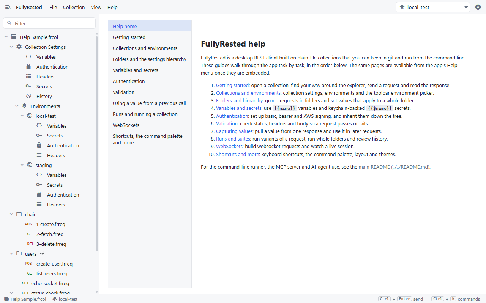

# FullyRested help

FullyRested is a desktop REST client built on plain-file collections that you can keep in git and run from the command line. These guides walk through the app task by task, in the order below. The same pages are available from the app's Help menu once they are embedded.

1. [Getting started](01-getting-started.md): open a collection, find your way around the explorer, send a request and read the response.
2. [Collections and environments](02-collections-and-environments.md): collection settings, environments and the toolbar environment picker.
3. [Folders and hierarchy](03-folders-and-hierarchy.md): group requests in folders and set values that apply to a whole folder.
4. [Variables and secrets](04-variables-and-secrets.md): use `{{name}}` variables and keychain-backed `{{$name}}` secrets.
5. [Authentication](05-authentication.md): set up basic, bearer and AWS signing, and inherit them down the tree.
6. [Validation](06-validation.md): check status, headers and body so a request passes or fails.
7. [Capturing values](07-capturing-values.md): pull a value from one response and use it in later requests.
8. [Runs and suites](08-runs-and-suites.md): run variants of a request, run whole folders and review history.
9. [WebSockets](09-websockets.md): build websocket requests and watch a live session.
10. [Shortcuts and more](10-shortcuts-and-more.md): keyboard shortcuts, the command palette, layout and themes.

For the command-line runner, the MCP server and AI-agent use, see the [main README](../../README.md).
